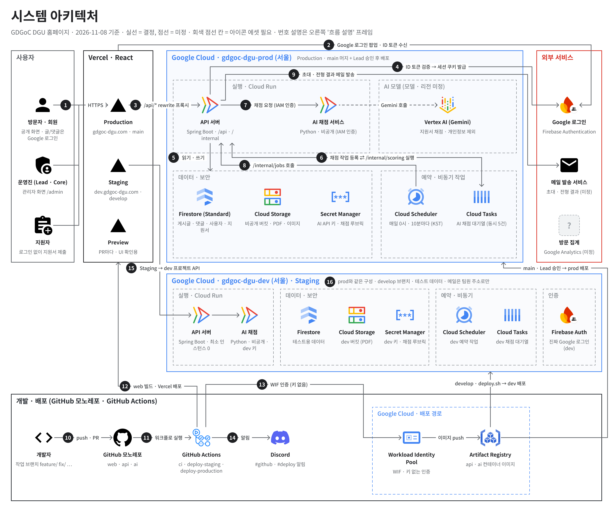

# GDGoC DGU 홈페이지

동국대학교 Google Developer Groups on Campus(GDGoC DGU) 홈페이지 팀 레포입니다.
프론트엔드, 백엔드, AI를 한 레포에서 폴더로 나눠 관리합니다. API 명세와 코드를 한곳에서 맞추기 위해서입니다.

## 폴더

| 폴더 | 내용 | 파트 |
| --- | --- | --- |
| `frontend/` | 웹 화면 (Vite + React + TypeScript, npm). 실행 방법은 [frontend/README.md](frontend/README.md) | FE |
| `backend/` | API 서버 (Spring) | BE |
| `ai/` | 지원서 채점 등 AI 기능 (FastAPI + uv) | AI |
| `infra/` | Firestore rules · indexes, Storage 설정 | 공통 |
| `scripts/` | 가짜 시드 데이터, `deploy.sh` 등 | 공통 |
| `RULEBOOKS/` | 작업 규칙 · 설정 문서 | 공통 |
| `.github/` | 이슈 · PR 템플릿, 자동화(workflow) | 공통 |

`backend/` 와 `ai/` 는 각 파트가 만들어 채웁니다.

## 규칙

- 명령은 각 폴더 안에서 실행합니다. 예: `cd frontend` 다음 `npm run dev`
- 브랜치 · PR 제목 규칙은 모든 파트 공통입니다. 브랜치는 아래에 요약했고, 전체는 [작업 규칙](RULEBOOKS/contributing.md)에 있습니다. 파트 안의 코드 규칙(폴더 구조 · 패턴)은 각 폴더 README 에 적습니다.
- 커밋은 AI 에게 맡기지 않고 각자 합니다.
- 이 레포는 Public 입니다. API 키 · `.env` · 실제 지원자/회원 정보는 어디에도 올리지 않습니다.

### 브랜치

작업 브랜치 → `develop` (squash merge) → `main` (merge commit, Lead 가 릴리스). `main` 과 `develop` 에는 직접 push 하지 않습니다. production 긴급 수정(`hotfix/`)만 `main` 에서 출발해 `main` 으로 PR 을 보내고, 이후 `develop` 으로 back-merge 합니다.

이름은 `<헤드>/<ID>-<짧은-설명>` 이고 전부 소문자 · 하이픈(kebab-case)입니다. ID 는 노션 ID 또는 이슈 번호이고, 둘 다 없으면 생략합니다.

| 헤드 | 작업 | 출발 |
| --- | --- | --- |
| `feature/` | 동작이 바뀌는 기능 | `develop` |
| `design/` | 보이는 것만 바뀌는 작업 (스타일, 퍼블리싱) | `develop` |
| `fix/` | 버그 수정 | `develop` |
| `hotfix/` | production 긴급 수정 | `main` |
| `task/` | 설정, CI/CD, 리팩터링, 테스트 등 | `develop` |
| `docs/` | 문서 | `develop` |

예: `feature/f-hom-001-hero-section`, `fix/58-apply-duplicate-check`, `task/ci-frontend-cache`

자세한 규칙은 [작업 규칙 › 브랜치 명명 규칙](RULEBOOKS/contributing.md#2-브랜치-명명-규칙)과 [머지 규칙](RULEBOOKS/merge-rules.md)을 보세요.

### 개발 흐름

1. (선택) 이슈 생성
2. 최신 `develop` 에서 작업 브랜치 생성 (`feature/`, `design/`, `fix/`, `task/`, `docs/`. 예: `feature/f-hom-001-hero-section`)
3. `develop` 으로 PR → `pr-title` 통과 (파트별 CI 가 있으면 함께 통과) → 작성자가 squash merge
4. staging(dev.gdgoc-dgu.com)에서 확인
5. 릴리스: Lead 가 `develop` → `main` 릴리스 PR 을 머지하고, production 배포는 Lead 가 승인

### 규칙 문서

처음이라면 [규칙 요약](RULEBOOKS/RULE_SUMMARY.md)부터 읽으세요.

| 문서 | 내용 |
| --- | --- |
| [규칙 요약](RULEBOOKS/RULE_SUMMARY.md) | 모든 규칙을 한 페이지로 요약하고 자세한 문서로 연결 |
| [작업 규칙](RULEBOOKS/contributing.md) | 작업 종류, 브랜치 이름, PR 제목, 작업 순서, 라벨 |
| [머지 규칙](RULEBOOKS/merge-rules.md) | 머지 조건, 릴리스, 핫픽스 |
| [레포 설정](RULEBOOKS/repo-settings.md) | Lead/PM용: 팀 · 권한, ruleset, 환경 설정값 |
| [실행 · 배포](RULEBOOKS/local-and-deploy.md) | 로컬 전체 실행, deploy.sh, 배포 workflow |

## 배포

| 환경 | 주소 | 기준 |
| --- | --- | --- |
| preview | PR 마다 Vercel 미리보기 (UI 확인용, 로그인 불가) | PR |
| staging | https://dev.gdgoc-dgu.com | `develop` 에서 `./scripts/deploy.sh` 실행 |
| production | https://gdgoc-dgu.com | `main` 머지 후 Lead 승인 |

- `frontend/`: Vercel (프로젝트 설정의 Root Directory 를 `frontend` 로 둠)
- 서버 · 인프라: GCP (GDG 계정)
- 자세한 내용은 [실행 · 배포](RULEBOOKS/local-and-deploy.md)

## 보안

취약점은 공개 이슈 대신 [Security 탭의 비공개 제보](../../security/advisories/new)로 알려주세요.

## 라이선스

이 레포에는 오픈소스 라이선스가 없습니다(All rights reserved). 코드는 공개되어 있어 누구나 볼 수 있지만, 허락 없이 복제 · 수정 · 배포할 수 없습니다. GitHub 이용약관에 따라 GitHub 안에서 보거나 포크하는 것은 가능합니다.
