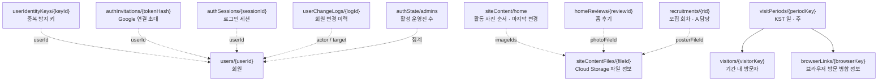

# 백엔드 Firestore 데이터 모델

| 영역 | 설계 문서 |
|---|---|
| AUTH · OPS (인증 · 회원 · 운영) | [AUTH-OPS](#auth-ops) |
| RCT (모집 · 지원) | [RCT 데이터 모델](rct-data-model.md) |

담당 영역의 설계를 이 문서에 추가하거나, 이미 작성한 설계 문서를 위 목록에 연결할 수 있습니다.

## AUTH-OPS

> 상태: **초안**. 구현 전에 관련 데이터의 담당자와 함께 검토합니다.
> 기준: [API 명세](../../docs/api/openapi.yaml)의 API-AUTH-001 ~ 013, API-OPS-001 ~ 013과 [RCT 데이터 모델](rct-data-model.md).
> Firestore는 스키마가 없으므로 이 문서와 backend의 저장 모델 클래스가 사실상의 스키마입니다. 구조를 바꾸면 이 문서도 함께 고칩니다.
> 현재 AUTH-001이 사용하는 `users` 필드와 `authSessions`는 구현에 맞췄습니다. 나머지 필드와 컬렉션은 설계안입니다.

### 1. 한눈에 보기

| 컬렉션 | 문서 하나 = | 쓰는 API |
|---|---|---|
| `users` | 회원 1명 | AUTH-001 ~ 012, RCT-027, OPS-011 |
| `userIdentityKeys` | 학번 또는 Google 계정의 소유권 1개 | AUTH-005 · 007 · 010, RCT-027, OPS-011 |
| `authInvitations` | 연결 초대 링크 1개 | AUTH-004 ~ 007 · 010, RCT-027, OPS-011 · 012 |
| `authSessions` | 로그인 1회로 발급된 세션 | AUTH-001 ~ 003 · 005 · 007 · 011 · 012, OPS-011 · 012 |
| `userChangeLogs` | 사용자 변경 작업 1건 | AUTH-005 ~ 007 · 010 ~ 013, RCT-027, OPS-011 |
| `authState` | 활성 운영진 수를 확인하는 공용 문서 | AUTH-010 ~ 012 |
| `siteContent` | 홈페이지 사진 순서와 영역별 마지막 변경 | OPS-001 ~ 008 |
| `homeReviews` | 후기 1건 | OPS-001 · 002 · 006 · 007 |
| `siteContentFiles` | 활동 사진 · 후기 사진 · 모집 포스터 파일 1개 | OPS-001 ~ 008, RCT-001 |
| `recruitments` | 모집 회차 1개. 포스터는 `posterFileId`로 연결 | OPS-001 · 002 · 008 · 009, RCT-001 |
| `visitPeriods` 및 `visitors` · `browserLinks` | 집계 기간, 기간 내 방문자, 같은 기간의 방문 병합 정보 | OPS-009 · 010 |

- OPS-009의 게시글 · 댓글 · 일정은 BRD · HOM · RCT의 원본 조회를 재사용합니다. OPS-013은 BRD-009 · PRJ-005의 파일 기록을 정리합니다. 두 기능 모두 별도 OPS 컬렉션을 만들지 않습니다.

### 2. 공통 규칙

- **시각**: Firestore `Timestamp`로 저장하고(UTC), 응답은 API 명세의 형식을 따릅니다. 날짜 검색 · 방문 집계 · 예약 실행은 KST 기준입니다. 날짜 범위는 시작일 0시 이상, 종료일 다음 날 0시 미만으로 조회합니다.
- **ID**: 사람이 읽는 접두어 + 무작위 문자열을 기본으로 합니다. 이미 발급한 회원 ID와 로그인 세션 ID는 유지합니다.

  | 대상 | 형식 | 예 | 만드는 방법 |
  |---|---|---|---|
  | 회원 | `usr_` + 무작위 문자열 | `usr_7f3c9k2m1x0q` | 신규 회원 등록 시 서버 생성. 기존 회원은 Firestore 문서 ID 유지 |
  | 중복 방지 키 | `student_` 또는 `google_` + HMAC | `student_<digest>` | 학번 또는 Google `sub`를 종류별로 구분해 서버 비밀키로 계산 |
  | 초대 링크 | SHA-256 해시 | `<tokenHash>` | 서버가 생성한 무작위 토큰을 해시 |
  | 세션 | UUID | `00000000-0000-4000-8000-000000000001` | 로그인 성공 시 서버 생성. 기존 형식 유지 |
  | 변경 이력 · 활동 사진 · 후기 | `log_` · `img_` · `review_` + 무작위 문자열 | `img_7f3c9k2m1x0q` | 서버 생성. 활동 사진은 `imageId`를 파일 ID로 사용 |
  | 후기 사진 · 포스터 파일 | `file_` + 무작위 문자열 | `file_7f3c9k2m1x0q` | 업로드마다 서버 생성 |
  | 방문 기간 | `d_YYYY-MM-DD` · `w_YYYY-MM-DD` | `d_2026-11-19` · `w_2026-11-16` | KST 날짜 또는 해당 주 월요일 |

- **enum 값**은 명세와 같은 대문자 문자열을 씁니다(`ADMIN`, `GENERAL` 등). 문서 키와 연결 상태처럼 서버가 계산하는 값은 응답을 만들 때 변환합니다.
- **삭제**: 회원은 먼저 비활성화합니다. 보유 기간이 지난 개인정보와 무효 인증 기록은 각 정리 작업에서 삭제합니다. 상위 문서 삭제로 하위 컬렉션이 함께 삭제되지는 않으므로 정리 범위를 명시합니다. [Firestore 데이터 삭제](https://firebase.google.com/docs/firestore/manage-data/delete-data)
- **개인정보**: 회원의 이름 · 학번 · 이메일 · Google 연결 정보는 `users`에 둡니다. 변경 이력에는 회원 문서 참조와 정해진 작업 문구만 기록합니다. Google ID 토큰 · refresh token · 초대 링크 원문은 DB나 로그에 저장하지 않습니다. 브라우저는 API를 통해 접근하며, Firestore 접근은 백엔드에서 처리합니다.

### 3. 컬렉션별 필드

#### 3-1. `users/{userId}` — 회원

| 필드 | 타입 | 설명 |
|---|---|---|
| `name` | string | 회원 이름 |
| `studentId` | string | 숫자 10자리. 등록 후 변경 불가 |
| `email` | string | 초대 메일 수신 주소 |
| `role` | string | `ADMIN` · `GENERAL` |
| `cohort` | number | 기수(정수) |
| `googleSub` · `googleEmail` | string \| null | 연결된 Google 계정의 고유 ID와 이메일. 로그인은 `googleSub`로 식별 |
| `isActive` | boolean | 로그인 및 보호 API 접근 가능 여부 |
| `authVersion` | number | 회원 단위 로그인 무효화 버전(0 이상의 정수). 필드가 없는 기존 문서는 현재 코드대로 `0`으로 읽음 |
| `activeInvitationKey` | string \| null | 마지막으로 활성화한 초대 문서의 ID. 연결 대기 여부는 `googleSub`로 판단 |
| `pendingInvitationKey` · `invitationLeaseUntil` | string \| null · timestamp \| null | 발송 중인 새 링크와 발송 예약 만료 시각 |
| `invitationRetryAt` | timestamp \| null | 초대 메일을 다시 요청할 수 있는 시각. 재발송 1분 제한에 사용 |
| `deactivatedAt` · `privacyDeleteAfter` | timestamp \| null | 비활성화 시각과 개인정보 정리 대상이 되는 시각 |
| `privacyState` | string | `PRESENT` · `DELETING` · `DELETED`. 중단된 정리 작업을 이어서 실행하는 데 사용 |
| `personalDataDeletedAt` | timestamp \| null | 개인정보 정리를 끝낸 시각 |
| `createdAt` · `updatedAt` | timestamp | 회원 등록 및 마지막 변경 시각 |

- AUTH-001은 현재 `googleSub`를 조회하고 `isActive`, `name`, `role`, `authVersion`을 읽습니다. 새 필드나 중복 방지 키를 도입할 때도 기존 회원 문서로 로그인할 수 있어야 합니다.
- AUTH-004 초대 확인과 AUTH-008 회원 목록은 학번을 가린 `maskedStudentId`를 반환합니다. AUTH-009 관리자 회원 상세는 원본 `studentId`를 반환합니다.
- AUTH-008 · 009의 `googleConnected`는 `googleSub`로 판단합니다. 미연결 회원은 `googleConnected: false`, `googleEmail: null`을 반환합니다.
- 비활성화 중에도 회원을 식별하는 키는 유지합니다. 비활성화 시각부터 1년이 지나면 개인정보를 정리하고 상태 확인에 필요한 최소 필드만 남깁니다. 학번 재등록 기준과 이에 따른 중복 방지 키의 삭제 정책은 구현 전에 정합니다.
- 개인정보 정리 쿼리를 적용하기 전, 기존 회원의 `privacyState`와 근거가 확인된 비활성화 시각을 채웁니다. Firestore 조건 조회에는 해당 필드 자체가 없는 문서가 포함되지 않습니다.

#### 3-2. `userIdentityKeys/{keyId}` — 회원 식별자 중복 방지

| 필드 | 타입 | 설명 |
|---|---|---|
| `kind` | string | `STUDENT_ID` · `GOOGLE_SUB` |
| `userId` | string | 식별자를 가진 회원 문서 ID |
| `createdAt` | timestamp | 키를 만든 시각 |

- 회원 등록 또는 Google 연결과 같은 트랜잭션에서 결정된 ID로 `create()` 합니다. 같은 학번이나 같은 Google 계정을 동시에 등록해도 하나의 문서만 해당 ID를 사용할 수 있습니다. 도입 전 기존 회원의 중복을 검사하고 유효한 값의 키를 먼저 생성합니다. [Firestore 트랜잭션](https://firebase.google.com/docs/firestore/manage-data/transactions)
- AUTH-010의 중복 응답은 학번 기준이고 RCT-027은 학번 또는 이메일로 명시되어 있습니다. 현재 설계의 공통 저장 제약은 학번과 Google 계정입니다. RCT-027의 이메일 판정과 두 API의 공통 등록 계약은 A와 맞춥니다.

#### 3-3. `authInvitations/{tokenHash}` — Google 연결 초대

| 필드 | 타입 | 설명 |
|---|---|---|
| `userId` | string | 초대받은 회원 ID |
| `status` | string | `PENDING_SEND` · `ACTIVE` · `USED` · `REVOKED` · `FAILED` |
| `createdAt` | timestamp | 초대 작성 시각 |
| `sentAt` · `expiresAt` | timestamp \| null | 발송이 확인된 시각과 그로부터 72시간 뒤 |
| `usedAt` · `revokedAt` | timestamp \| null | 사용 또는 무효화 시각 |
| `deleteAfter` | timestamp | 활성 링크는 `expiresAt`, 사용 · 무효 · 실패 링크는 처리 시각, 발송 대기 링크는 예약 만료 시각을 기준으로 설정 |

- 연결은 `ACTIVE` 상태, 만료 전, 회원의 `activeInvitationKey` 일치 및 연결 가능 상태를 모두 확인합니다. 재발송 성공 전에는 기존 링크가 유지됩니다. 발송 결과를 DB에 기록할 때 예약이 여전히 유효한지도 확인합니다.

#### 3-4. `authSessions/{sessionId}` — 로그인 세션

| 필드 | 타입 | 설명 |
|---|---|---|
| `userId` | string | 로그인한 회원의 문서 ID |
| `authVersion` | number | 발급 당시의 회원 인증 버전 |
| `refreshTokenHash` | string | refresh token의 SHA-256 해시(Base64url) |
| `createdAt` · `expiresAt` | timestamp | 첫 로그인 시각과 1시간 뒤의 최종 만료 시각 |
| `deleteAfter` | timestamp | 최초에는 `expiresAt`. 로그아웃 등 세션을 직접 무효화할 때 정리 기준을 갱신 |
| `revokedAt` | timestamp \| null | 세션 무효화 시각. 발급 시 `null` |

- access token은 DB에 저장하지 않습니다. 갱신한 access token의 유효 기간은 15분과 세션 만료까지 남은 시간 중 짧은 값입니다. 세션의 `revokedAt` · `expiresAt`, 회원의 `isActive` · `authVersion`을 확인해 정리 작업 전에도 무효 토큰의 접근을 차단합니다.

#### 3-5. `userChangeLogs/{logId}` — 사용자 변경 이력

| 필드 | 타입 | 설명 |
|---|---|---|
| `type` | string | AUTH-013의 이벤트 종류. 예: `USER_CREATED`, `ROLE_CHANGED`, `PERSONAL_DATA_DELETED` |
| `createdAt` | timestamp | 작업 시각 |
| `actor` | map | `{ type: ADMIN · SELF · SYSTEM, userId: string \| null }`. 시스템 처리에는 `userId: null` |
| `target` | map | `{ userId: string \| null }`. 단일 회원을 대상으로 하지 않는 작업은 `userId: null` |
| `content` | string | 개인정보를 넣지 않는 작업 문구. 예: `회원 계정을 비활성화함` |

- `actor.name` · `target.name`은 조회할 때 회원 문서에서 읽습니다. 따라서 회원 이름이 수정되면 이력에도 현재 이름이 표시됩니다. 개인정보 정리 때 이력의 해당 참조를 `null`로 바꾸고, 삭제가 완료된 회원은 `userId`와 `name` 모두 `null`로 응답합니다.

#### 3-6. `authState/admins` — 활성 운영진 수

| 필드 | 타입 | 설명 |
|---|---|---|
| `activeCount` | number | 활성 상태의 `ADMIN` 회원 수(정수) |
| `updatedAt` | timestamp | 마지막 변경 시각 |

- 기존 활성 운영진 수로 초기화합니다. 운영진 등록 · 역할 변경 · 활성 상태 변경은 회원과 이 문서를 같은 트랜잭션에서 반영해 동시에 요청해도 최소 1명이 남도록 합니다.

#### 3-7. `siteContent/home` — 활동 사진 순서 · 마지막 변경

| 필드 | 타입 | 설명 |
|---|---|---|
| `imageIds` | string[] | 활동 사진 파일 ID를 화면 순서대로 저장. 비어 있으면 `[]`, 최대 8개 |
| `lastModified.images` · `lastModified.reviews` · `lastModified.recruitmentPoster` | map \| null | `{ updatedAt, updatedByUserId }`. 변경 이력이 없으면 `null` |

- `sortOrder`는 배열 위치에 1을 더해 반환합니다. 변경자 이름과 파일 URL은 응답을 만들 때 조회합니다.
- OPS-004는 현재 `imageIds`를 트랜잭션에서 읽고, 마지막 사진을 삭제하려는 요청은 `409 / LAST_IMAGE_REQUIRED`로 처리합니다.
- OPS-005는 중복 ID를 `400 / VALIDATION_FAILED`로 처리합니다. 트랜잭션에서 전달된 ID 목록이 현재 등록된 사진 전체와 일치하는지 확인합니다. 다르면 `409 / IMAGE_LIST_CHANGED`를 반환하고, 일치하면 전달된 순서로 전체 배열을 한 번에 저장합니다.
- 모집 포스터는 [RCT 모델의 `recruitments/{rid}`](rct-data-model.md#3-1-recruitmentsrid--모집-회차)에 있는 `posterFileId`를 읽습니다. 화면에 표시할 모집 회차는 RCT-001과 같은 선택 기준을 사용합니다.

#### 3-8. `homeReviews/{reviewId}` — 홈페이지 후기

| 필드 | 타입 | 설명 |
|---|---|---|
| `cohort` | number | 기수(정수) |
| `name` · `part` · `content` | string | 등록한 표시 이름 · 파트 · 후기. 후기는 최대 200자 |
| `isPublic` | boolean | 공개 여부. 등록 시 기본값 `true` |
| `photoFileId` | string \| null | 후기 사진 파일 참조 |
| `createdAt` · `updatedAt` | timestamp | 등록 및 변경 시각 |

- 공개 홈페이지는 `isPublic: true`인 후기만 읽습니다. 관리자 화면은 비공개 후기도 읽습니다.
- OPS-007에서 `photo`를 전달하면 사진을 교체하고, `removePhoto: true`를 전달하면 `photoFileId`를 `null`로 바꾸고 기존 파일을 삭제합니다. 두 항목을 함께 요청하면 `400 / VALIDATION_FAILED`입니다. 새 사진이 없고 `removePhoto`가 생략되거나 `false`면 기존 사진을 유지합니다.

#### 3-9. `siteContentFiles/{fileId}` — 운영 콘텐츠 파일 정보

| 필드 | 타입 | 설명 |
|---|---|---|
| `kind` | string | `HOME_IMAGE` · `REVIEW_PHOTO` · `RECRUITMENT_POSTER` |
| `objectPath` | string | Cloud Storage 객체 경로. 업로드마다 새 경로 사용 |
| `generation` | string \| null | 업로드된 객체의 버전. 재시도 시 의도한 객체만 삭제하는 데 사용 |
| `contentType` · `sizeBytes` | string · number | MIME 타입과 크기. JPG · PNG, 활동 사진 5MB · 후기 사진 2MB · 포스터 10MB 이하 |
| `status` | string | `PENDING` · `ATTACHED` · `DELETE_PENDING` |
| `createdAt` · `updatedAt` | timestamp | 업로드 준비 및 마지막 상태 변경 시각 |

- 파일 본문은 Cloud Storage에, 연결 정보는 Firestore에 저장합니다. URL은 조회 시 만듭니다. 파일 교체 · 삭제가 중간에 실패하면 재시도할 수 있도록 기존 파일 기록을 남깁니다. 이 컬렉션은 OPS-013이 정리하는 BRD · PRJ 파일과 별도의 초안입니다. [Cloud Storage 요청 사전조건](https://docs.cloud.google.com/storage/docs/request-preconditions)

#### 3-10. `visitPeriods/{periodKey}` — 자체 방문 집계 기간

| 필드 | 타입 | 설명 |
|---|---|---|
| `startAt` · `endAt` | timestamp | 해당 일 · 주의 시작과 종료 경계. 종료는 범위에 포함하지 않음 |

#### 3-11. `visitPeriods/{periodKey}/visitors/{visitorKey}` — 기간 내 방문자

| 필드 | 타입 | 설명 |
|---|---|---|
| `firstSeenAt` | timestamp | 해당 기간에 처음 집계된 시각. 브라우저 또는 계정별 문서 1개 |

#### 3-12. `visitPeriods/{periodKey}/browserLinks/{browserKey}` — 방문 병합 기록

| 필드 | 타입 | 설명 |
|---|---|---|
| `accountVisitorKey` | string | 같은 기간의 브라우저 방문을 합친 계정 방문 키 |

- 방문 키는 **기간 및 종류가 포함된 HMAC**으로 계산합니다. 회원 ID · 브라우저 식별값 원문 · 이메일 · IP · 화면 경로는 방문 집계에 저장하지 않습니다. `pagePath`는 관리자 화면 제외 등에만 사용합니다.
- `today`와 `thisWeek`는 해당 기간의 `visitors` 문서 수를 각각 `count()`로 구합니다. 같은 브라우저로 방문 후 로그인하면 비로그인 문서를 계정과 합칩니다. 일별 방문자 수를 더해서 주간 인원을 구하면 같은 사람이 반복 집계되므로 두 기간을 각각 기록합니다. [Firestore 집계 쿼리](https://firebase.google.com/docs/firestore/query-data/aggregation-queries)

### 4. 주요 쓰기 흐름 (트랜잭션 경계)

| API | 한 트랜잭션에서 하는 일 | 트랜잭션 밖 |
|---|---|---|
| AUTH-001 Google 로그인 | 활성 회원과 인증 버전을 확인하고 세션 생성 | Google ID 토큰 검증. 세션 저장 성공 후 응답으로 access token과 refresh 쿠키 전달 |
| AUTH-002 · 003 갱신 · 로그아웃 | 갱신 시 세션과 회원 상태 확인. 로그아웃 시 유효한 쿠키의 세션을 무효화하고 정리 가능 시각 갱신 | access token 발급 또는 쿠키 제거. 로그아웃은 세션이 없어도 성공 응답 |
| AUTH-005 계정 연결 | 초대와 회원 상태 재확인 → Google 키 확보 · 연결 → 초대 소진 · 세션 저장 · 변경 이력 기록 | Google ID 토큰 검증, 완료 후 토큰 응답 |
| AUTH-006 초대 재발송 | 발송 예약 후, 성공을 확인한 별도 트랜잭션에서 새 링크 활성화 · 이전 링크 무효화 · 이력 기록. 실패 시 이전 링크 유지 | 메일 발송. 메일 수락 여부가 확인되지 않으면 성공 처리로 기록하지 않고 복구 기준을 적용 |
| AUTH-007 연결 해제 | Google 키 해제 · 연결 정보 초기화 · `authVersion` 증가 · 이전 초대 무효화 · 이력 기록 | 새 초대 발송은 커밋 후 시도. 메일 실패 시에도 연결 해제 유지 |
| AUTH-010 · RCT-027 회원 등록 | 학번 키와 신규 회원 생성 · 운영진 수 갱신(해당 시) · 등록 이력 기록. RCT-027도 같은 회원 등록 서비스를 호출 | 회원 등록 확정 후 초대 메일 발송. 메일만 실패해도 등록 유지, AUTH-006으로 재발송 |
| AUTH-011 · 012 역할 · 활성 상태 변경 | 본인 비활성화 제한 및 변경 후 운영진 최소 1명 확인 → 변경 · 인증 버전 갱신(역할 변경 · 비활성화) · 삭제 예약 변경 · 이력 기록. 일괄 요청은 모든 대상에 대해 성공하거나 모두 취소 | 여러 세션 문서의 물리 정리는 정리 작업에서 처리 가능. 버전이 낮은 세션은 인증 시점에 이미 거부 |
| OPS-003 ~ 008 활동 사진 · 후기 · 포스터 변경 | 참조와 `lastModified` 변경. 교체 시 새 파일은 `ATTACHED`, 연결을 잃은 파일은 `DELETE_PENDING`. 포스터는 A의 모집 회차 원본에 연결 | 파일 업로드를 먼저 완료하고, 참조 갱신 후 이전 파일 삭제. 실패한 파일은 상태를 남겨 재시도 |
| OPS-010 방문 집계 | 일 · 주 기간 각각의 방문자와 병합 기록을 확인하고 한 번에 갱신. 한 기간이라도 인원이 실제로 늘어난 경우 `counted: true` | 화면 경로와 서버가 확인한 방문자 식별 정보 검증 |
| OPS-011 개인정보 정리 | 비활성 상태 · 기한을 다시 확인하고 `DELETING`으로 처리 시작. 정리 완료 후 회원의 개인정보 제거 · `DELETED` 전환 · 시스템 이력 기록 | 매일 03시(KST). 회원 세션 · 초대 · 식별 키 · 관련 이력을 정리하며 중단된 작업 재개. A와 지원서 및 관련 문서 정리. 완료된 대상만 결과에 집계 |
| OPS-012 만료 기록 정리 | 예약 작업을 선택하면 삭제 직전에 링크 또는 세션의 만료 · 무효 · 처리 상태를 재확인 | 정리 방식 및 시각은 미정. 정리 이후에도 회원의 Google 연결 상태는 유지하고, 인증할 때 만료와 무효 여부를 확인 |
| OPS-013 미연결 파일 정리 | C의 파일 기록에서 여전히 미연결인지 확인해 삭제 중으로 전환. Storage 삭제가 끝난 후 해당 기록 삭제 | 매시간 정각(KST) 최대 500개. 업로드 · 연결 해제 후 24시간 지난 대상부터 처리. Storage 파일이 이미 없어도 기록 정리를 계속하고, 둘 다 끝난 파일만 집계 |

- 조회용 AUTH-004 · 008 · 009 · 013 및 OPS-001 · 002 · 009는 업무 데이터를 변경하지 않습니다. Google · 메일 · Cloud Storage 호출은 재시도되는 Firestore 트랜잭션 바깥에 둡니다. [Firestore 트랜잭션](https://firebase.google.com/docs/firestore/manage-data/transactions)
- AUTH-012가 OPS-011의 정리 시작보다 먼저 성공하면 삭제 예약을 취소합니다. 정리 진행 중 · 완료 후 재활성화의 처리 기준은 구현 전에 확인합니다.

### 5. 조회 방식과 인덱스

| 컬렉션 | 필드 | 쓰는 곳 |
|---|---|---|
| `users` | `googleSub` (단일) | AUTH-001의 기존 로그인 조회 |
| `users` | `role` (단일) | AUTH-008의 운영진 · 일반 회원 필터 |
| `users` | `isActive ASC, privacyState ASC, privacyDeleteAfter ASC` (복합 후보) | OPS-011의 기한 도달 및 정리 재개 대상 조회 |
| `authInvitations`, `authSessions` | `userId` · `deleteAfter` (각각 단일) | 회원별 정리 및 기한 도달 기록 조회 |
| `userChangeLogs` | `createdAt DESC` (단일), `type ASC, createdAt DESC` (복합 후보) | AUTH-013 날짜 범위 · 최신순 · 유형 필터 |
| `userChangeLogs` | `actor.userId` · `target.userId` (각각 단일) | OPS-011의 이력 식별정보 정리 |
| `homeReviews` | `isPublic` (단일) | OPS-001 공개 후기 조회 |
| `visitPeriods/{periodKey}/visitors` | 기간 문서의 하위 컬렉션 `count()` | OPS-009 오늘 · 이번 주 방문자 수 |
| BRD · HOM · RCT · PRJ 원본 | 각 담당의 조회 필드 및 인덱스 | OPS-009의 게시글 · 댓글 · 일정과 OPS-013의 미연결 파일 |

- AUTH-008 키워드는 이름 · 학번 · 등록 이메일 · Google 이메일에서, AUTH-013 키워드는 처리자 · 대상 이름 및 내용에서 검색합니다. 초안은 권한 확인 후 역할 또는 날짜 · 유형으로 조회 범위를 좁히고 서버에서 키워드를 비교한 뒤 페이지를 계산하는 방식입니다. 회원 목록은 기본 20건, 최대 100건입니다. 변경 이력은 기본 최근 30일(KST)이며 최신순, 페이지당 20건입니다.
- OPS-009는 Teams · Community의 최신 게시글과 댓글을 각각 최대 5건 읽고, 실제 숫자 ID와 게시판 구분을 사용합니다. 새 글 · 댓글 수는 최근 24시간 기준입니다. 일정은 기능 명세 `F-HOM-004`와 같은 선정 기준으로 가까운 순서대로 최대 4건을 읽습니다.
- 복합 인덱스는 쿼리를 구현한 뒤 실제 필요한 조합을 [인덱스 설정](../../infra/firebase/firestore.indexes.json)에 반영합니다.

### 6. 다른 담당과 맞출 것

| 상대 | 맞출 내용 |
|---|---|
| A(모집 · 지원 · 일정) | RCT-027이 공유할 회원 생성 · 초대 서비스의 입력과 중복 판정. 학번은 문자열, 기수는 정수, 역할은 `GENERAL`. `ALREADY_MEMBER`와 등록 후 메일만 실패한 `INVITATION_FAILED`를 구분 |
| A(모집 · 지원 · 일정) | OPS-008은 `recruitments/{rid}.posterFileId`에 연결. RCT-001 · OPS-001 · OPS-002가 포스터 파일 정보를 같은 방식으로 읽고, OPS-009는 `F-HOM-004`의 일정 선정 기준을 재사용 |
| A(지원서 정리) | OPS-011이 제출 시각부터 1년을 계산. 지원서 원본과 중복 키 · 검토 메모 · 이력 · 메일 수신자 기록 중 지울 정보와 보존할 정보의 기준을 [RCT 데이터 모델](rct-data-model.md)과 맞춤 |
| C(게시판 · 프로젝트) | OPS-009에 제공할 글 · 댓글의 실제 ID 및 조회 상태. 개인정보 삭제 이후 기존 글 · 댓글의 작성자 표시와, OPS-013에서 사용할 파일 연결 상태 · 미연결 시작 시각 · Storage 경로 확인. 삭제 중인 파일은 다시 연결하지 않도록 연동 |
| FE | OPS-010의 브라우저 식별 정보 전달, 로그인 직후 호출, 같은 브라우저에서 계정을 바꾸는 경우의 집계 기준. 다른 API는 현재 API 명세의 필드 사용 |
| 인프라 | OPS-011 · 013 스케줄과 서비스 계정 권한. OPS-012 정리 방식에 따른 TTL 또는 Scheduler 설정. 운영 콘텐츠 파일의 삭제 재시도 처리 |

### 7. 미결 사항

- **AUTH-007** 이미 Google 연결이 해제된 회원에게 같은 요청이 다시 들어왔을 때의 응답과 초대 메일 처리.
- **OPS-010** 자체 집계에서 브라우저 식별 정보를 발급 · 전달하는 방식과 로그인 직후 프론트가 방문 정보를 보내는 시점. 브라우저를 여러 계정이 쓰는 경우와 집계 데이터 보유 기간도 함께 확인.
- **OPS-011** 개인정보 삭제 후 기존 글 · 댓글에 표시할 작성자 이름, A/C와 맞춰야 할 개인정보 정리 범위, 정리 시작 이후 회원 복구와 학번 재등록 기준.
- **OPS-012** TTL 또는 예약 작업 중 정리 방식, 예약 작업 실행 시각, 정리 후 AUTH-002에서 세션을 찾지 못했을 때의 오류 코드.
- AUTH-010과 RCT-027의 이메일 중복 판정, 메일 수락 여부가 불확실한 발송 복구 방식, 운영 콘텐츠 파일의 삭제 재시도 주체는 관련 구현 전에 확정합니다.
- 위 결정은 해당 기능을 구현하기 직전에 확인합니다.
