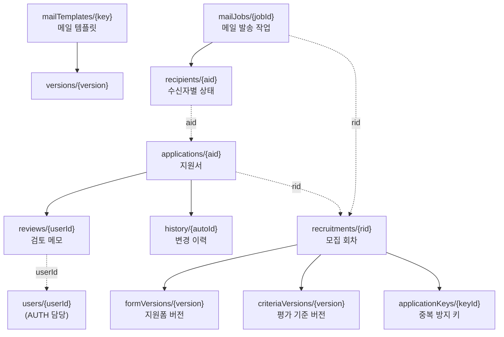

# RCT(모집 · 지원) Firestore 데이터 모델 — 초안

> 상태: **초안**. 구현 전에 RCT 담당 · AUTH 담당 · FE와 함께 검토합니다.
> 기준: `docs/api/openapi.yaml`의 API-RCT-001 ~ 034 (RCT-021 · 024 · 029 · 005 보강안 포함).
> Firestore는 스키마가 없으므로 이 문서와 backend의 저장 모델 클래스가 사실상의 스키마입니다. 구조를 바꾸면 이 문서도 함께 고칩니다.
> Notion 정리본: [홈페이지 DB 설계](https://app.notion.com/p/41cfc36f5b7b809ca3dadc886603b1b5) — 이 문서가 기준이고, 바꾸면 Notion도 맞춥니다.

## 1. 한눈에 보기



| 컬렉션 | 문서 하나 = | 쓰는 API |
|---|---|---|
| `recruitments` | 모집 회차 1개 (기수당 1개) | RCT-001 · 006 · 007 · 008 · 020 · 030, OPS-008 |
| `recruitments/{rid}/formVersions` | 지원폼 한 버전 | RCT-002 · 009 · 010 · 011 |
| `recruitments/{rid}/criteriaVersions` | 평가 기준 한 버전 | RCT-011 · 012 · 013 · 028 |
| `recruitments/{rid}/applicationKeys` | 학번 또는 이메일 하나의 "사용 중" 표시 | RCT-003 · 005 · 032 · 033 |
| `applications` | 지원서 1건 | RCT-005 · 014 ~ 021 · 024 · 027 ~ 033 |
| `applications/{aid}/reviews` | 운영진 1명의 검토 메모 | RCT-016 · 018 |
| `applications/{aid}/history` | 변경 1건 | RCT-016 · 019 · 020 · 021 · 032 · 033 |
| `mailTemplates` | 템플릿 1종(`DOC_PASS` 등)의 최신본 | RCT-022 · 023 · 034 |
| `mailTemplates/{key}/versions` | 템플릿 한 버전 | RCT-023 · 024 |
| `mailJobs` | 일괄 발송 작업 1건 | RCT-024 · 025 · 026 |
| `mailJobs/{jobId}/recipients` | 작업 안의 수신자 1명 | RCT-025 · 026 · 029 |

## 2. 공통 규칙

- **시각**: Firestore `Timestamp`로 저장하고(UTC), 응답에서 KST(`+09:00`) ISO 8601로 바꿉니다.
- **ID**: 사람이 읽는 접두어 + 무작위 문자열. `rid`만 기수에서 만듭니다.

  | 대상 | 형식 | 예 | 만드는 방법 |
  |---|---|---|---|
  | 모집 회차 | `rct_{cohort}` | `rct_5` | 기수당 1개라 기수로 정함. `create()`가 실패하면 `COHORT_EXISTS` |
  | 지원서 | `a_` + 무작위 12자 | `a_7f3c9k2m1x0q` | 서버 생성 |
  | 발송 작업 | `mj_` + 무작위 12자 | `mj_01h2...` | 서버 생성 |
  | 사용자 | `usr_...` | `usr_001` | AUTH 담당 규칙을 따름 |

- **enum 값**은 명세와 같은 대문자 문자열로 저장합니다(`PENDING`, `PASS` 등).
- **삭제**: 지원서는 지우지 않고 `deleted: true`로 바꿉니다(RCT-033). 실제 삭제는 보존 기간 뒤 OPS-011이 합니다.
- **개인정보**: 지원자 원본 정보는 `applications/{aid}.applicant`에만 둡니다. 문서 ID · 로그 · 이력에는 넣지 않습니다(중복 키는 해시, 이메일 변경 이력은 가림).

## 3. 컬렉션별 필드

### 3-1. `recruitments/{rid}` — 모집 회차

| 필드 | 타입 | 설명 |
|---|---|---|
| `cohort` | number | 기수(양의 정수). 문서 ID와 맞춤 |
| `title` | string | |
| `status` | string | `DRAFT` · `SCHEDULED` · `OPEN` · `CLOSED` (RCT-008 전이표) |
| `closedManually` | boolean | RCT-008로 수동 마감했는지. `applyState: CLOSED_MANUALLY` 판단에 씀 |
| `applyStartAt` · `applyEndAt` | timestamp | 시작 · 종료 시각 모두 포함 |
| `tracks` | string[] | `["BE","FE","AI","Mobile"]` |
| `noticeMarkdown` | string | |
| `posterFileId` | string \| null | OPS-008로 등록한 파일. `posterUrl`은 응답 때 만듦 |
| `latestFormVersion` | number \| null | 가장 최근 폼 버전 (RCT-009 기본 조회) |
| `publishedFormVersion` | number \| null | 게시된 폼 버전. `null`이면 `applyState: NOT_PUBLISHED` |
| `currentCriteriaVersion` | number \| null | 현재 평가 기준 버전. `null`이면 게시 불가(`CRITERIA_NOT_READY`) |
| `stages.DOCUMENT` · `stages.INTERVIEW` | map | `{ confirmed: boolean, confirmedAt, confirmedBy, unlockedReason }` — RCT-020 전형 확정 |
| `membersRegistered` | boolean | RCT-027로 한 명이라도 등록했는지. `true`면 기수 변경 불가(`COHORT_LOCKED`) |
| `createdAt` · `updatedAt` | timestamp | |
| `createdBy` · `updatedBy` | string | userId |

- `applyState`와 `canApply`는 **저장하지 않고** 매번 계산합니다(RCT-001 · 005 · 030이 같은 함수 사용).
- 지원자 수(`applicationCount`, RCT-006)도 저장하지 않고 `count()` 집계로 구합니다. 회차가 적어 비용이 작습니다.

### 3-2. `recruitments/{rid}/formVersions/{version}` — 지원폼 버전

문서 ID는 버전 번호 문자열(`"3"`).

| 필드 | 타입 | 설명 |
|---|---|---|
| `version` | number | |
| `status` | string | `DRAFT` · `PUBLISHED` |
| `questions` | array\<map\> | `{ questionId, type, title, description, maxLength, options[], trackOnly[] }` |
| `updatedAt` · `updatedBy` · `updatedByName` | | RCT-009 응답의 `updatedBy`(이름)를 위해 이름도 복사 |
| `publishedAt` · `publishedBy` | timestamp · string | 게시 때만 |

- 게시된 버전은 수정하지 않습니다. 초안 저장(RCT-010)은 최신 버전이 `DRAFT`면 덮어쓰고, `PUBLISHED`면 새 버전을 만듭니다.
- 문항이 최대 수십 개라 배열 하나로 둡니다(문서 크기 한도 1MiB에 한참 못 미침).

### 3-3. `recruitments/{rid}/criteriaVersions/{version}` — 평가 기준 버전

| 필드 | 타입 | 설명 |
|---|---|---|
| `version` | number | |
| `items` | array\<map\> | `{ itemId, name, questionIds[], guide, weight }` — AI `/grading` 요청과 같은 이름 |
| `createdAt` · `createdBy` | | |

- 저장할 때마다 새 버전을 만들고 `recruitments.currentCriteriaVersion`을 올립니다(같은 트랜잭션).

### 3-4. `recruitments/{rid}/applicationKeys/{keyId}` — 중복 지원 방지

| 문서 ID | 예 |
|---|---|
| `sid_` + 해시(정규화 학번) | 학번 공백 제거, 숫자 10자리 |
| `email_` + 해시(정규화 이메일) | 소문자 · 공백 제거 |

| 필드 | 타입 |
|---|---|
| `aid` | string |
| `createdAt` | timestamp |

- 회차 아래에 두므로 "같은 회차에서만" 중복이라는 규칙이 경로로 표현됩니다.
- **RCT-003**: `sid_` 문서가 있는지만 봅니다.
- **RCT-005**: 트랜잭션 안에서 두 키 문서를 읽고, 하나라도 있으면 `APPLICATION_DUPLICATED`, 없으면 지원서와 두 키를 함께 만듭니다. 동시 제출도 한쪽만 성공합니다.
- **RCT-032**: 이전 이메일 키를 지우고 새 키를 만듭니다(트랜잭션). 새 키가 이미 있으면 `APPLICATION_DUPLICATED`.
- **RCT-033**: 지원서를 삭제 상태로 바꾸면서 두 키를 지워 재지원을 허용합니다.
- 해시는 문서 ID에 학번 · 이메일 원문이 드러나지 않게 하려는 것입니다. 학번은 경우의 수가 적어 단순 해시는 되돌리기 쉬우므로 **HMAC(서버 비밀 키)** 를 권장합니다(7장 미결 사항).

### 3-5. `applications/{aid}` — 지원서

`rid`로 걸러 조회하지만, 관리자 API가 `aid`만으로 접근하므로(`/admin/applications/{aid}`) **최상위 컬렉션**에 둡니다.

| 필드 | 타입 | 설명 |
|---|---|---|
| `rid` · `cohort` | string · number | |
| `formVersion` | number | 제출한 폼 버전 |
| `applicant` | map | `{ name, studentId, major, email, phone }` 원본. 상세(RCT-016)에서만 그대로 반환 |
| `track` | string | |
| `answers` | array\<map\> | `{ questionId, value?, values? }` |
| `privacyConsent` | map | `{ agreed: true, agreedAt }` — AI 채점 활용 동의 포함 |
| `submittedAt` | timestamp | |
| `deleted` | boolean | 기본 `false` |
| `deletedAt` · `deletedBy` · `deleteReason` | | RCT-033 |
| `currentStage` | string | `DOCUMENT` · `INTERVIEW`. 목록 `stage` 필터용(서류 합격 후 `INTERVIEW`) |
| `scoring` | map | 아래 표 |
| `stages` | map | 아래 표 |
| `member` | map \| null | RCT-027 결과 `{ status, userId, registeredAt, reason }` |
| `updatedAt` | timestamp | |

`scoring` (RCT-014 · 016 · 028 · 031):

| 필드 | 타입 | 설명 |
|---|---|---|
| `status` | string | `PENDING` · `RUNNING` · `DONE` · `FAILED` |
| `criteriaVersion` | number | 이 지원서가 따라야 할 기준 버전. 결과가 다른 버전이면 버림(`SKIPPED_STALE`) |
| `runId` | string \| null | 지금 유효한 채점 실행 번호. RCT-028이 시작할 때 새로 기록하고, 결과는 이 값이 같을 때만 저장(늦게 끝난 이전 실행 결과 버림) |
| `totalScore` | number \| null | 항목 점수의 합. 소수 1자리(0.0~100.0). 목록의 `aiScore` |
| `items` | array\<map\> | `{ itemId, name, level, weight, score, reason }`. `score = level / 5 × weight`, 소수 1자리(항상 0.2 배수) |
| `model` · `promptVersion` · `instructionIgnored` | | AI 응답 그대로 |
| `requestedAt` · `startedAt` · `scoredAt` | timestamp | RCT-031이 `PENDING` 5분 · `RUNNING` 10분 초과를 찾을 때 씀 |
| `attempts` | number | 3회 초과 시 `FAILED` |
| `error` | string \| null | 실패 사유 코드 |

상태 전이 (RCT-028 · 031):

```text
PENDING ──(028 시작, runId 기록)──▶ RUNNING ──(결과 저장, runId 일치)──▶ DONE
   ▲                                   │
   ├──(028 AI 일시 실패, attempts+1)───┤──(AI 422 · 3회 초과)──▶ FAILED
   └──(031: RUNNING 10분 초과)─────────┘
```

- `RUNNING`을 그대로 다시 넣으면 RCT-028이 "이미 RUNNING"으로 건너뛰므로, 다시 넣을 때는 항상 `PENDING`으로 바꾼다.
- 점수는 실수 오차를 피하려고 0.1 단위 정수(`level × weight × 2`)로 계산한 뒤 소수 1자리로 저장한다.

`stages` (RCT-016 · 019 · 021 · 024 · 029):

```text
stages: {
  DOCUMENT:  { result: PENDING|PASS|FAIL, resultFixed: bool, mailStatus: NOT_SENT|SENT|FAILED },
  INTERVIEW: { result: PENDING|PASS|FAIL, resultFixed: bool, mailStatus: NOT_SENT|SENT|FAILED,
               interview: { startAt, endAt, durationMin, location, interviewerIds: [userId] } | null }
}
```

- `interview.endAt = startAt + durationMin`을 저장해 두면 겹침 검사(`SLOT_CONFLICT`)가 단순해집니다.
- 목록의 `mailStatus`는 `currentStage`의 값을 돌려줍니다.

### 3-6. `applications/{aid}/reviews/{userId}` — 검토 메모

문서 ID가 작성자 `userId`라서 "작성자별로 하나, 본인 것만 수정"이 경로로 지켜집니다.

| 필드 | 타입 |
|---|---|
| `reviewerName` | string (작성 당시 이름 복사) |
| `memo` | string |
| `manualScore` | number \| null (0~100) |
| `updatedAt` | timestamp |

### 3-7. `applications/{aid}/history/{autoId}` — 변경 이력

| 필드 | 타입 | 설명 |
|---|---|---|
| `action` | string | `RESULT_CHANGED` · `STAGE_UNLOCKED` · `INTERVIEW_SCHEDULED` · `EMAIL_CHANGED` · `DELETED` · `RESCORE_REQUESTED` 등 |
| `stage` | string \| null | |
| `before` · `after` | string \| null | `EMAIL_CHANGED`는 가린 값(`ho***@dgu.ac.kr`)만 저장 |
| `reason` | string \| null | 확정 해제 · 삭제 사유 |
| `actorUserId` · `actorName` | string | |
| `at` | timestamp | |

### 3-8. `mailTemplates/{key}` 와 `versions/{version}` — 메일 템플릿

`key`는 `DOC_PASS` · `DOC_FAIL` · `FINAL_PASS` · `FINAL_FAIL`. 회차와 상관없이 공용입니다(명세 경로에 `rid`가 없음).

| 필드 | 타입 |
|---|---|
| `subject` · `bodyMarkdown` | string |
| `version` | number |
| `updatedAt` · `updatedBy` | |

- 저장(RCT-023)마다 `versions/{version}`에 사본을 남기고 최신본을 갱신합니다.
- 사용 가능 변수 목록(`name`, `major` …)은 코드 상수로 둡니다.

### 3-9. `mailJobs/{jobId}` 와 `recipients/{aid}` — 메일 발송

`mailJobs/{jobId}`:

| 필드 | 타입 | 설명 |
|---|---|---|
| `rid` · `stage` | string | `DOCUMENT` · `FINAL` |
| `status` | string | `RUNNING` · `DONE` |
| `attempt` | number | 재발송(RCT-026)마다 +1 |
| `total` | number | |
| `templates` | map | `{ DOC_PASS: { version, subject, bodyMarkdown }, ... }` — 발송 당시 템플릿 고정 |
| `createdAt` · `createdBy` · `finishedAt` | | |

`mailJobs/{jobId}/recipients/{aid}`:

| 필드 | 타입 | 설명 |
|---|---|---|
| `templateKey` | string | |
| `status` | string | `QUEUED` · `SENT` · `FAILED` |
| `error` | string \| null | `INVALID_EMAIL`, `MAIL_AUTH_FAILED` 등 |
| `attempts` · `lastAttemptAt` · `sentAt` | | |

- `sent` · `failed` 수(RCT-025)는 저장하지 않고 `status`별 `count()`로 구합니다. 재발송으로 성공하면 자동으로 옮겨 세어집니다.
- 실패 목록의 `name`은 응답 때 지원서에서 읽습니다(개인정보를 작업 문서에 복사하지 않음).
- 받는 주소는 발송 시점의 지원서 이메일입니다(RCT-026 규칙).

## 4. 주요 쓰기 흐름 (트랜잭션 경계)

| API | 한 트랜잭션에서 하는 일 | 트랜잭션 밖 |
|---|---|---|
| RCT-005 제출 | 회차 읽기(접수 가능 · `publishedFormVersion == formVersion`) → 키 2개 확인 → 지원서 + 키 2개 생성 | 채점 작업 등록(Cloud Tasks). 실패해도 RCT-031이 다시 넣음 |
| RCT-011 게시 | 기준 버전 확인 → 폼 버전 `PUBLISHED` → 회차 `publishedFormVersion` 갱신 | |
| RCT-013 기준 저장 | 새 기준 버전 생성 → 회차 `currentCriteriaVersion` 갱신 | `needsRescore`는 저장 후 집계 |
| RCT-019 일괄 결과 | 최대 500건이라 **배치 쓰기**를 나눠 실행. 건별로 지원서 갱신 + 이력 | 건별 성공 · 제외를 모아 응답 |
| RCT-028 채점 시작 | `PENDING`이면 `RUNNING` + 새 `runId` 기록. 이미 `RUNNING`이면 건너뜀 | |
| RCT-028 채점 결과 | 지원서를 다시 읽어 `criteriaVersion` · `runId`가 같을 때만 결과 저장. AI 일시 실패면 `PENDING`으로 되돌림 | AI 호출은 트랜잭션 **밖**(재시도 때 중복 호출 방지) |
| RCT-031 멈춘 채점 | 여전히 멈춘 상태인지 확인 후 `PENDING` + `requestedAt` 갱신 | 채점 작업 다시 등록 |
| RCT-029 메일 1건 | 수신자 `SENT` + 지원서 `stages.{stage}.mailStatus = SENT` · `resultFixed = true` | Gmail 호출은 트랜잭션 **밖**. 이미 `SENT`면 호출 안 함 |
| RCT-033 삭제 | 지원서 `deleted = true` + 키 2개 삭제 + 이력 | |

## 5. 조회 방식과 인덱스

회차당 지원서는 수백 건 이하로 예상되므로, **목록은 회차 단위로 한 번 읽고 서버 메모리에서 거르고 정렬 · 페이지 나누기**를 합니다.

- 이유 1: `keyword`(이름 · 학과 · 이메일 **부분** 검색)는 Firestore가 지원하지 않습니다.
- 이유 2: `track` · `stage` · `result` · `scoringStatus` × `sort` 조합마다 복합 인덱스가 필요해집니다.
- 지원자가 수천 건으로 늘면 이 방식을 다시 검토합니다.

`infra/firebase/firestore.indexes.json`에 넣을 복합 인덱스(초안):

| 컬렉션 | 필드 | 쓰는 곳 |
|---|---|---|
| `applications` | `rid` ASC, `deleted` ASC, `submittedAt` DESC | RCT-015 목록 기본 조회 |
| `applications` | `scoring.status` ASC, `scoring.requestedAt` ASC | RCT-031 멈춘 채점 찾기 |
| `applications` | `rid` ASC, `stages.INTERVIEW.interview.interviewerIds` CONTAINS | RCT-021 면접관 일정 겹침 |

`recruitments`는 문서가 몇 개뿐이라 전부 읽어 메모리에서 고릅니다(RCT-001 현재 회차, RCT-030 일일 작업).

## 6. 다른 담당과 맞출 것

| 상대 | 맞출 내용 |
|---|---|
| AUTH | `users/{userId}`의 `name` · `role`(`ADMIN`/`GENERAL`) · 활성 여부 필드 이름(RCT-021 면접관 검증), 현재 사용자 정보를 얻는 공통 코드, RCT-027에서 부를 회원 생성 진입점과 중복 기준(학번 · 이메일) |
| OPS | 포스터 파일 참조 방식(`posterFileId` vs URL 저장), OPS-011 개인정보 정리 때 지울 필드와 컬렉션(`applications`, `applicationKeys`, `reviews`, `history`, `recipients`) |
| HOM | 모집 기간을 바꾸면 일정도 바뀌는 연결 방식(RCT-008) |
| FE | 관리자 화면의 데이터 계층이 아직 예전 API(`ARC-*`)와 회차 없는 구조를 씀. `rid` 기준으로 맞추기 |

## 7. 미결 사항

1. **중복 키 해시**: HMAC 비밀 키를 둘지(권장), 둔다면 Secret Manager · 환경변수 이름.
2. **지원서 원본 개인정보 암호화**: 필드 단위 암호화까지 할지, Firestore 기본 암호화로 충분한지.
3. **검토 메모**: "작성자별로 쌓인다"가 운영진 1명당 메모 1개인지, 여러 개인지. 이 초안은 1개로 봄.
4. **메일 템플릿 범위**: 회차 공용(이 초안)인지, 회차별인지.
5. **`currentStage` 전환 시점**: 서류 `PASS` 저장 때 바로 `INTERVIEW`로 바꿀지, 서류 전형 확정(RCT-020) 때 바꿀지.
6. **이력 보존**: 지원서 삭제(OPS-011) 때 이력도 함께 지울지.
